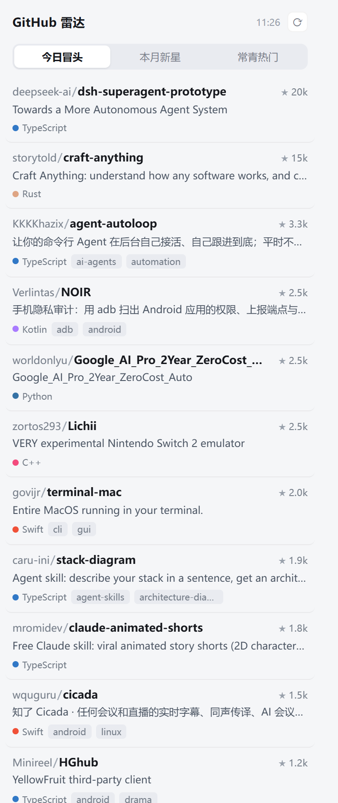

# GitHub Radar for DeepSeek Harness

A right-sidebar panel that shows what is actually taking off on GitHub: four lists ranked by **star velocity**, plus keyword search. One click opens the repository.

右侧栏面板，打开即显示 GitHub 上真正在起量的项目：四个档位按**星标增速**排序，外加关键词搜索。点击一行直达仓库。



## No GitHub account needed / 不需要 GitHub 账号

This plugin **never asks you to log in**. It reads GitHub's public Search API anonymously — no token, no OAuth, no account, no credentials of any kind. Nothing about your GitHub identity is read, stored, or sent anywhere.

It calls `api.github.com` and nothing else. There is no telemetry.

本插件**不会要求你登录 GitHub**。它以匿名身份读取 GitHub 公开的 Search API —— 不需要 token、不需要 OAuth、不读取任何账号或凭据。它只访问 `api.github.com`，没有遥测。

If you have no proxy and your network can reach GitHub directly, it just works. See [Network behaviour](#network-behaviour) for what happens when it cannot.

## What it does

Four lists, each the top 30:

| List | Query | Ranked by |
| --- | --- | --- |
| **今日 Today** | created within 2 days, 3+ stars | stars per day |
| **本周 This week** | created within 7 days, 20+ stars | stars per day |
| **本月 This month** | created within 30 days, 100+ stars | stars per day |
| **常青 Giants** | 20k+ stars, pushed within 30 days | total stars |

**Why stars per day, not total stars.** A repository that gained 2,000 stars in three days is more worth your attention than one that gained 3,000 in six months, but the second always wins a total-stars sort. The three rising lists therefore fetch a pool of candidates and re-rank locally by `stars ÷ days since creation`. Each row shows that rate — `+460/day` — next to the language. For the Giants list total stars is the right measure, so it stays.

**Search.** Type a keyword and the panel queries GitHub directly. Matching is GitHub's own: the term is matched against repository name, description, README and topics, so both `rust` and `中文` work. Results are sorted by stars. Space-separated terms are ANDed by GitHub, which is why `awesome list` returns 23k results rather than 2M.

Two details that matter in practice:

- **Debounced 500 ms**, so typing does not fire a request per keystroke.
- **IME-aware.** While a Chinese/Japanese/Korean input method is composing (拼音 not yet committed), no request is sent. It fires on `compositionend`, so typing 「中文」 costs one request, not one per pinyin keystroke.

## Install

```sh
dsh plugin --profile web add github:goodboys155/dsh-github-radar
```

Then restart DSH. The tab appears in the **right** sidebar as 「雷达」/「Radar」.

Restart is required: DSH scans client plugins at startup only. Editing files on disk does not hot-reload the browser half.

## Network behaviour

Outbound requests go **direct first**, using Node's global `fetch` (undici), which keeps a connection pool and reuses TLS sessions — an order of magnitude faster than a hand-rolled `https.request` per call.

If direct fails, it probes these local proxy ports and only tries the ones actually listening:

```
127.0.0.1:10808   (v2rayN default)
127.0.0.1:10809
127.0.0.1:7890    (Clash default)
127.0.0.1:7897
127.0.0.1:1080
```

That probe costs a few milliseconds per port. **If direct fails and no proxy is listening, you get an error in about 6 seconds** — not after trying five ports at 15 seconds each. A machine without a proxy is a normal, supported configuration; it just reports the failure quickly instead of hanging.

The first proxy that answers is remembered for the rest of the process.

## Data source and caching

[GitHub Search REST API](https://docs.github.com/en/rest/search/search), `repositories` endpoint, unauthenticated.

Unauthenticated search allows 10 requests per minute. The plugin is sized well under that:

- **30 minutes** in memory and on disk for the four lists (`$DSH_HOME/github-radar/trending-<period>.json`)
- **5 minutes** in memory for a given search keyword

The refresh button forces a fetch. If GitHub is unreachable, the last successful list keeps rendering with an `离线缓存` / `cached` badge instead of an empty panel.

## Architecture

```
index.js          host   — GET /api/github-radar/trending?period=day|week|month|all
                           GET /api/github-radar/search?q=<keywords>
client.js         client — sidebar tab: four-period switcher, search box, list
cordis.patch.yml  bundle patch
```

Both routes are loopback-only and `GET`-only. Fetching from the browser would hit CORS and expose your proxy configuration to the page, which is why the outbound request lives on the host.

## Permissions

Declared capabilities: **network** only.

- No filesystem writes outside `$DSH_HOME/github-radar/` (the cache)
- No shell, no subprocess, no environment variable reads
- No credentials, no tokens, no GitHub account

## Requirements

- DeepSeek Harness 0.2.0 line or newer
- Windows, macOS or Linux (host half uses Node built-ins only)

## Known limits

- 30 entries per list, 30 search results. No "load more".
- Descriptions are shown as GitHub returns them — mostly English. No translation.
- The Today list depends on repositories being created *and* already gaining stars within 2 days; on quiet days it can be thin.
- Search results are sorted by stars, so a precise match with few stars can sit below a popular near-match. That is GitHub's ranking, not a filter.
- Star counts are a point-in-time snapshot, cached up to 30 minutes.
- Hitting refresh repeatedly can exhaust the 10/minute unauthenticated quota; GitHub then answers 403 until the window resets. The cache usually prevents this.

## License

MIT — see [LICENSE](LICENSE).
